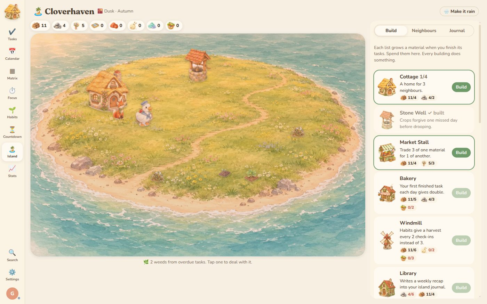
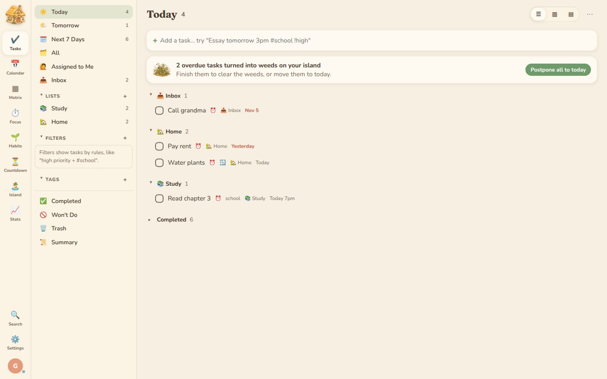
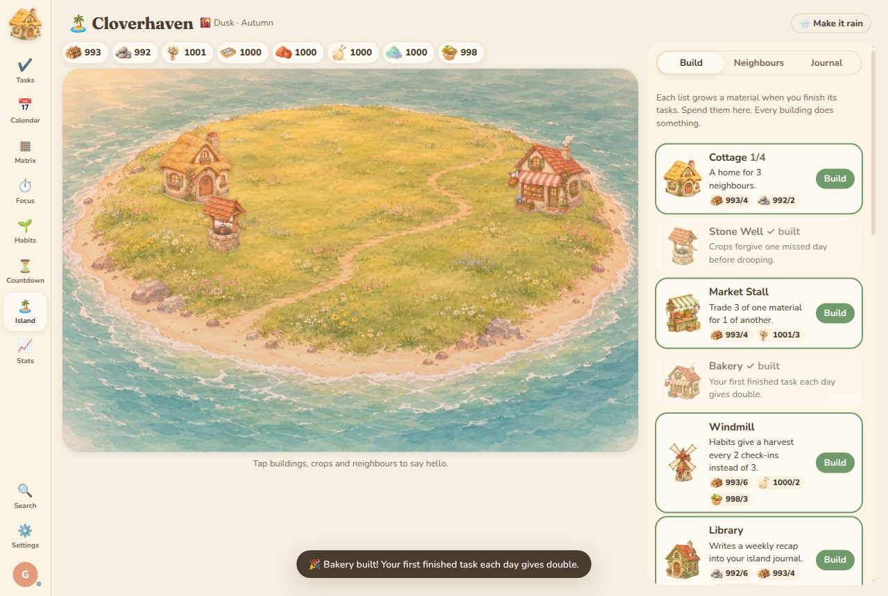
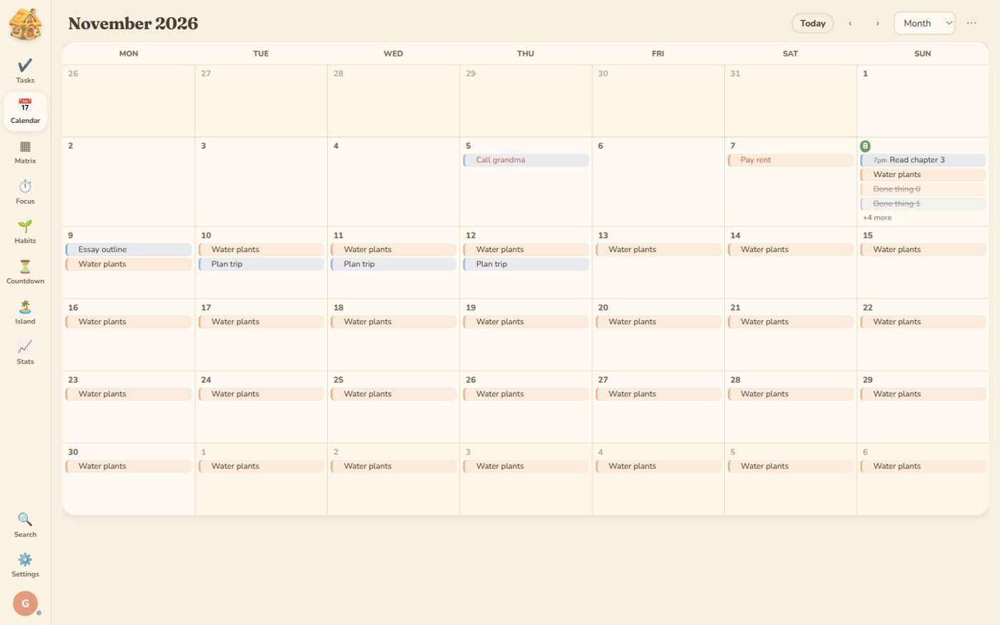
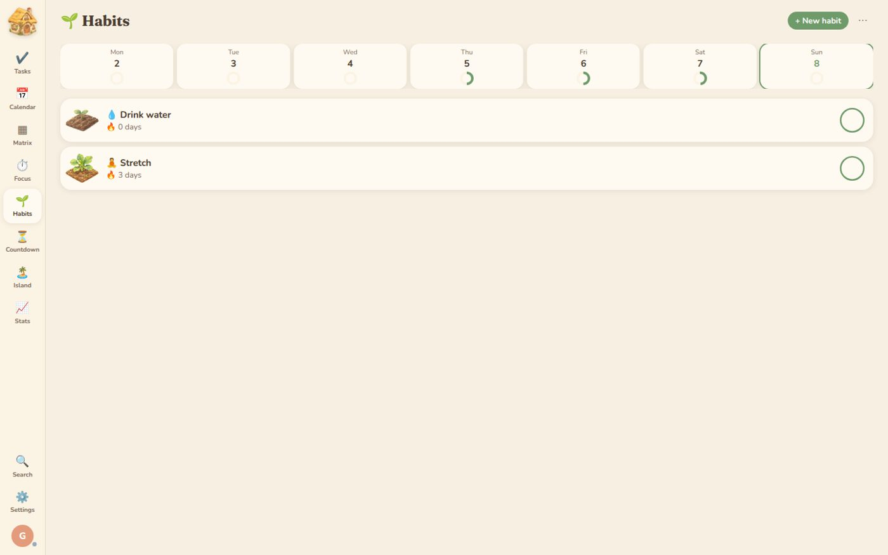

<div align="center">



<h1>🏝️ Pocket Isle</h1>

<p><b>A planner with every TickTick feature a website can have, plus a little island village<br>that grows from the things you actually get done.</b></p>

<p>
<a href="#-how-the-island-works">How the island works</a> ·
<a href="#-everything-it-can-do">Features</a> ·
<a href="#-tips">Tips</a> ·
<a href="#-run-it-yourself">Run it yourself</a>
</p>

</div>

---

## 🌿 The idea

No XP, no levels, no points. Finishing tasks gathers **materials**. You spend them on **buildings** for your island, and **critter neighbours** move in depending on how you plan.

Everything on the island is painted in a soft watercolor style.

<table>
<tr>
<td width="50%"></td>
<td width="50%"></td>
</tr>
<tr>
<td width="50%"></td>
<td width="50%"></td>
</tr>
</table>

## 🏝️ How the island works

| You do this | The island does this |
|---|---|
| Finish a task | You get materials. Each list gives its own kind: wood, stone, petals, fish, clay, wool, sea glass or harvest. You can pick which one in the list's settings. |
| Finish a high priority or big task | You get more materials, and rarer ones. |
| Check in a habit | That habit's crop grows: seed, then sprout, then full plant. Miss a few days and it droops, but it never dies. |
| Leave a task overdue | Weeds show up on the island. Finish the task or move it to today and they're gone. |
| Run a focus session | It rains on the island while the timer runs, and you find sea glass afterwards. |
| Plan in certain ways | Hidden neighbours show up: an owl if you work late, a duck for clearing your inbox, and so on. You find out the rest yourself. |

**Buildings do things.** The Cottage houses neighbours, the Well forgives a missed habit day, the Market lets you trade materials, the Bakery doubles your first task of the day, and the Library writes you a weekly recap.

You can move buildings around and build on the shore. The island also changes with the time of day and the season.

## ✅ Everything it can do

**Tasks**
- Inbox, lists, folders, list colours and emoji, archived lists, note lists
- Quick add that understands normal sentences: `Essay tomorrow 3pm #school !high`
- Subtasks (as deep as you like), checklists, notes with formatting, file attachments, comments
- Due dates, start dates and date ranges, times, all-day tasks, durations
- Several reminders per task, with browser notifications
- Repeating tasks: daily, weekly on chosen days, monthly, yearly, workdays only, "after I finish it", and end after a date or a number of times
- 4 priority levels, nested tags, pin to top, "won't do", trash with restore
- Sort and group by date, priority, list, tag or title. Drag to reorder, or drop a task on another task to make it a subtask
- Select several tasks at once to change their dates, priority, list or tags together
- Templates you can save and reuse
- Assign tasks to people in a shared list

**Views**
- Smart lists: Today, Tomorrow, Next 7 Days, All, Assigned to me, Inbox, Completed, Won't Do, Trash
- List, Kanban board (with sections) and Timeline
- Calendar: month, week, 3 days, day and agenda. Drag tasks to reschedule them, and see subscribed calendars too
- Eisenhower matrix with rules you can change
- Saved filters (list, tag, date, priority, keyword)
- Search, plus a command menu (press `Ctrl/⌘ K`)
- Statistics and a summary you can copy, download or print

**Focus**
- Pomodoro and stopwatch, with long breaks, auto-start and strict mode
- Ambient sounds: rain, ocean, forest, café, fireplace, library, lofi, thunder
- Link a session to a task, add notes, and add past sessions by hand

**Habits**
- Daily, specific weekdays, X times a week, or every N days
- Goals like "8 glasses", streaks, a monthly calendar and a note for each day

**Countdowns** for exams, birthdays and anniversaries (they can repeat every year)

**Account and sync**
- Sign up with email and password. Your tasks sync across all your devices
- Share a list with friends, assign tasks to them and comment together
- Use it without an account. Anything you made as a guest moves into your account when you sign up
- Works offline and syncs once you're back online. You can install it like an app from your browser

**Settings**
- 7 themes (Cream, Sage, Sky, Rose, Lavender, Night, Ocean), text size, 12/24 hour clock, first day of the week
- Default list, date, priority and reminders for new tasks
- Show or hide each smart list
- Subscribe to calendars (Google, Apple, Outlook links) or import `.ics` files
- Import from **TickTick** (their CSV backup), export a full backup, CSV, text or `.ics`

**What a website can't do:** home screen widgets, Siri/assistant shortcuts, location reminders and email-to-task. Those need a phone app.

## 💡 Tips

- Press `N` to add a task, `/` to search and `Ctrl/⌘ K` for the command menu. Press `?` to see every shortcut.
- In quick add, `#tag` adds a tag, `~List` picks a list, `!high` sets the priority, and words like "every monday" make it repeat.
- Right-click (or long-press on a phone) any task to see all its options.
- Click a weed on the island to deal with its task straight away.

## 🛠️ Run it yourself

You need Python 3.

```bash
python3 server.py
```

Then open http://localhost:8000. Accounts are saved in `data/cloverhaven.db`.

**Putting it online (Vercel):** import the repo into Vercel and add a Postgres database (for example Neon). Vercel adds the `DATABASE_URL` or `POSTGRES_URL` setting for you, and the app uses it automatically.

---

<div align="center">
<sub>Made by <a href="https://github.com/Lyra-4leafclover">Lyra</a> · <a href="https://x.com/Lyra_void">@Lyra_void</a> · <a href="https://lyradossier.vercel.app/">lyradossier</a><br>Ambient sounds are credited in <code>public/audio/CREDITS.txt</code>.</sub>
</div>
